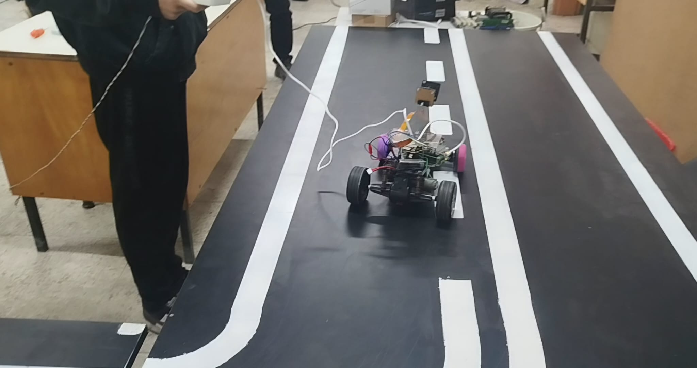
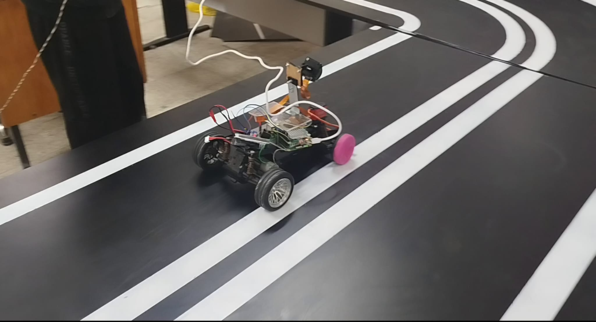
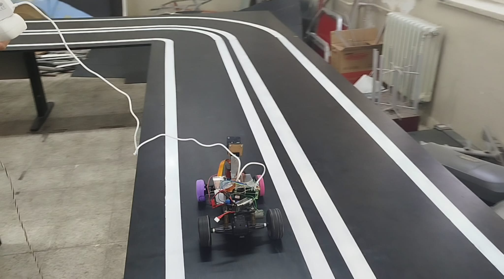
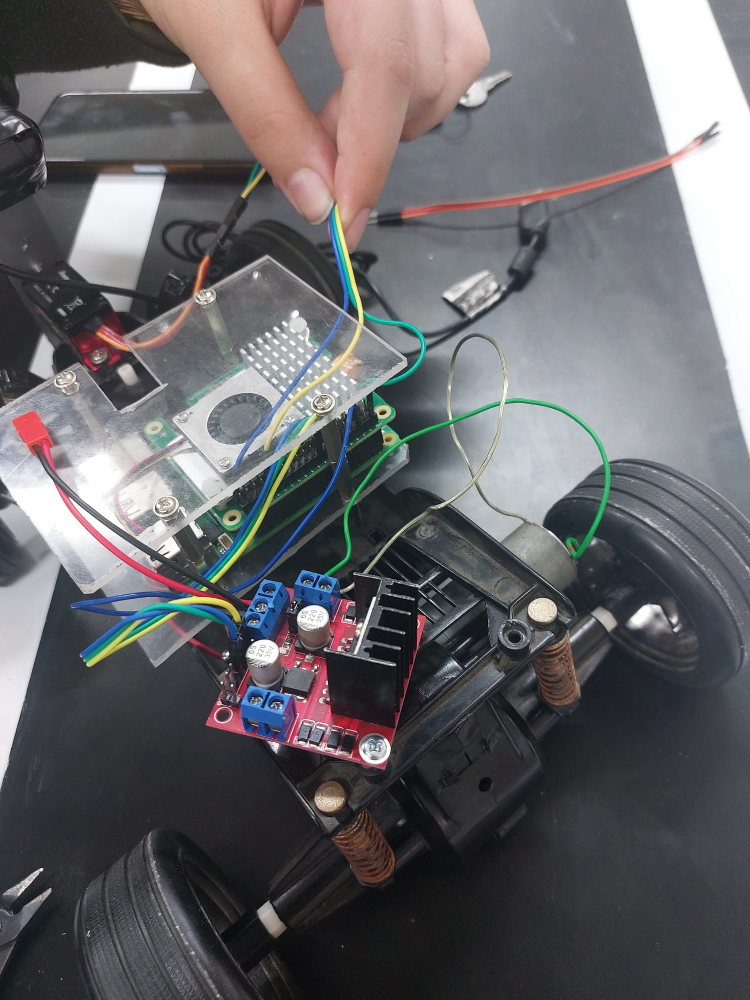
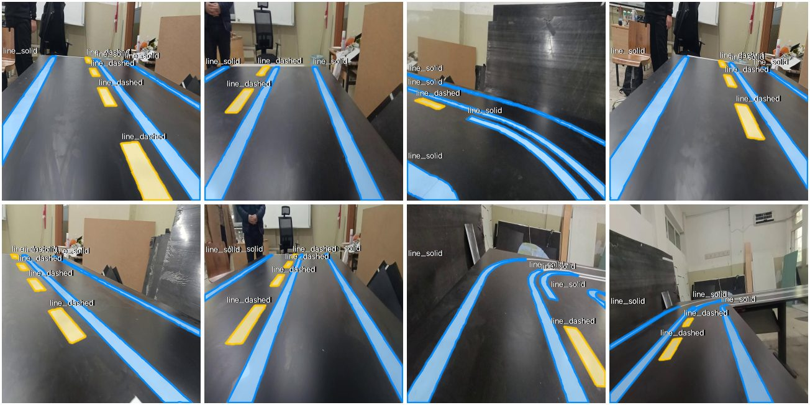
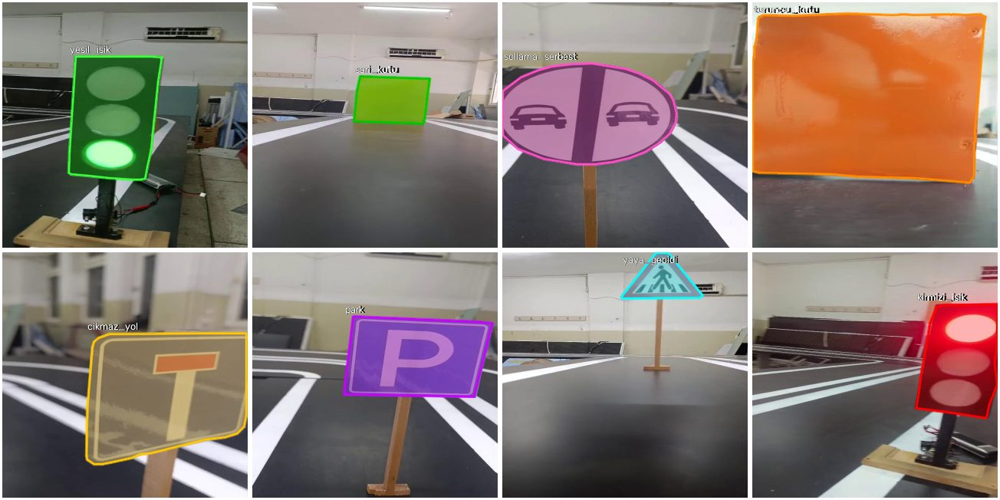
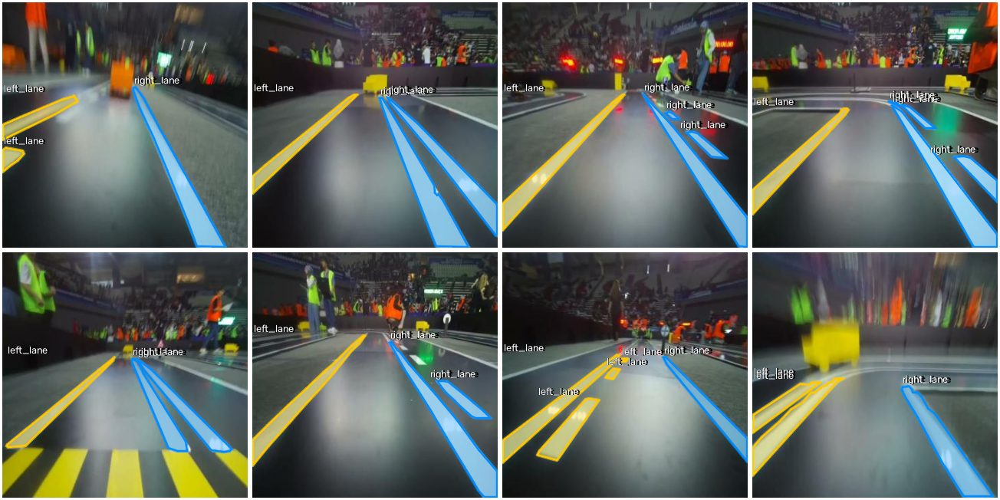

# Autonomous Vehicle — 18th MEB Robot Competition

A small self-driving car I built alone for the **Fully Autonomous Car** category of the
**18th International MEB Robot Competition** (Turkey, 2026). It runs on a **Raspberry Pi 5**
with a **Hailo-8L** AI accelerator and a Pi camera. It follows lanes on a black track with
white lines and recognises road signs, traffic lights and obstacles.

Everything here was written, tuned and tested on the car itself between December 2025 and
April 2026. I also collected, labelled and trained the datasets for all three models.

> 🇹🇷 Türkçe özet en altta.

<p align="center">
  
  
  
</p>
<p align="center"><em>The car driving on the test track</em></p>

<p align="center">
  
</p>
<p align="center"><em>Close-up of the electronics</em></p>

> **Note:** Later in the project, the car's body and the placement of the circuits were
> redesigned from scratch.

---

## The competition

The 18th International MEB Robot Competition took place in **Antalya, 6–8 May 2026**. In the
Autonomous Vehicle category the car must fit in a 20 × 30 × 25 cm box, may use **only cameras**
(no other sensors) and must run software written by the team. On one 4-minute lap it has to start
at a traffic light, stop at pedestrian and level crossings, pass a speed bump, overtake a vehicle,
avoid a dead end and park in the red parking area.

The official category guide (English and Turkish) and a rules summary are in
[`docs/competition/`](docs/competition/).

## The track

```
 |   ||   |      4 white lines on a black floor = 2 lanes
 |   ||   |      the car drives in one lane and keeps between the two nearest lines
```

The track also has pedestrian crossings, dead-end / parking / speed-bump / overtaking signs,
traffic lights and yellow/orange boxes as obstacles.

## Hardware

| Part | Details |
|---|---|
| Computer | Raspberry Pi 5 |
| AI accelerator | Hailo-8L (runs the compiled `.hef` lane model) |
| Camera | Raspberry Pi camera via `Picamera2` (1280×720, processed at 640 px wide) |
| Steering | Servo on GPIO 12 (`gpiozero.AngularServo`, `lgpio` pin factory) |
| Drive | DC motor through an L298N driver: IN1 → GPIO 23, IN2 → GPIO 24, ENA → GPIO 18 |

---

## How the project evolved

The commit history follows the real timeline of the project (see the note at the end).

| When | What happened | Files |
|---|---|---|
| **Dec 2025** | First tests on the Hailo-8L: a GStreamer + `hailonet` pipeline with a ready-made pose-estimation model. | `experiments/hailo_bringup/gemini_calisan.txt` |
| **Feb 2026** | Collected and labelled the **otonom_18th_int** dataset on our test track and trained my own **YOLOv8-seg lane model** (classes `line_dashed`, `line_solid`, 416×416) and compiled it to `best.hef` for the Hailo-8L. Then made the NPU output usable: checking the output tensors, finding the quantization parameters and decoding the segmentation masks by hand. | `best.hef`, `labels.json`, `experiments/hailo_bringup/*` |
| **Mar 2026** | Built the first full driving app: Hailo segmentation masks → lane centre → **PD steering** (`LaneFollower`). Wrote motor/servo tests and a **C++ (pybind11) module** to speed up lane processing on the Pi. | `hailo_app.py`, `hailo_app_hef.py`, `lane_follower.py`, `config.py`, `lane_native/`, `hardware_tests/` |
| **Apr 2026** | Built the **road_signs** dataset and trained a second **YOLOv8-seg model for road signs and obstacles** (dataset v3, then v4 with traffic lights). | `best.pt`, `road_model.pt`, `road_sign_test.py` |
| **Apr 2026** | **Switched lane following to classic OpenCV** — bird's-eye view + sliding windows + PID. Added a live calibration tool and tuned everything for the competition. This is the version the car used in the competition. | `lane_opencv.py`, `bev_calibrator.py`, `motor_control.py` |
| **May 2026** | Recorded footage on the **real competition track**, labelled it as a new dataset (FAST_O_M18: left/right lane) and trained a YOLOv11-seg model on it in Roboflow. | [FAST_O_M18 dataset](https://universe.roboflow.com/otonom-cc19j/fast_o_m18/dataset/2) |

---

## Final lane pipeline (`lane_opencv.py`)

```
camera frame
  → crop the sky / far area
  → brightness threshold + blur  → white-line mask
  → perspective warp              → bird's-eye view (BEV)
  → remove pedestrian-crossing stripes (skipped while turning)
  → histogram peaks + sliding windows → left / right line points
  → 2nd-order polynomial fit + LaneMemory (rejects sudden jumps, keeps last good lane)
  → steering error from the lane centre
  → PID controller                → servo angle
  → adaptive speed                → DC motor
```

Details worth mentioning:

- **PID controller** with an integral limit (anti-windup), a low-pass filtered derivative and a
  small dead-zone so the car does not twitch on straight lines.
- **TurnTracker** remembers the direction and curvature of the current turn, so the car keeps
  turning when a line disappears in a sharp corner.
- **Small-error boost:** if a small steering error keeps pointing the same way for ~40 frames,
  the steering gain ramps up (max ×2.5) to remove slow drift.
- **Adaptive speed:** slows down in curves, when only one line is visible, when no line is
  found, and at pedestrian crossings.
- **Single-line mode:** if only one line is visible, the car decides whether it is the left or
  right line (without confusing the middle `||` double line) and estimates the other side from
  the tracked lane width.
- **Two live windows** ("Kamera" with the lane overlay and PID values, "Algilama" with the BEV
  mask and sliding windows) and keyboard controls while driving:
  `a` autonomous on/off · `SPACE` emergency stop · `+`/`-` brightness threshold · `z`/`x` servo trim · `q` quit.

The diff between the 10 April and 25 April commits of `lane_opencv.py` shows the competition
tuning: lower base speed (the small chassis oscillated at high speed), a longer look-ahead,
wider lane-width limits and the small-error boost.

---

## Models

| File | Task | Classes | Training |
|---|---|---|---|
| `best.hef` | Lane segmentation on Hailo-8L | `line_dashed`, `line_solid` | YOLOv8-seg, 416×416, compiled for Hailo-8L (Feb 2026) |
| `best.pt` | Road signs & obstacles (dataset v3) | dead end, level crossing, parking, yellow box, overtaking allowed, speed bump, orange box, pedestrian crossing | YOLOv8n-seg, 640, 120 epochs (6 Apr 2026) |
| `road_model.pt` | Road signs & obstacles (dataset v4) | the 8 above + red, yellow, green traffic light (11 classes) | YOLOv8n-seg, 640, 120 epochs (22 Apr 2026) |

Turkish class names used in the models: `cikmaz_yol`, `hemzemin`, `park`, `sari_kutu`,
`sollama_serbest`, `tumsek`, `turuncu_kutu`, `yaya_gecidi`, `kirmizi_isik`, `sari_isik`, `yesil_isik`.

On its own validation split, `road_model.pt` reached mask mAP50 ≈ 0.99. The validation images
come from the same track, so real-world accuracy is lower than this number.

---

## Datasets

I collected and labelled all three datasets myself in Roboflow. The full datasets are public on
Roboflow Universe and can be downloaded in YOLOv8 and other formats:

| Dataset | What it contains | Classes | Images | Link |
|---|---|---|---|---|
| **otonom_18th_int** (v5, Feb 2026) | Our own test track | `line_dashed`, `line_solid` | 744 labelled (1,188 in v5 with augmentation) | [Roboflow Universe](https://universe.roboflow.com/otonom-cc19j/otonom_18th_int/dataset/5) |
| **road_signs** (v4, Apr 2026) | The signs, traffic lights and boxes we built for the track | 11 classes (see above) | 683 labelled (1,693 in v4 with augmentation) | [Roboflow Universe](https://universe.roboflow.com/otonom-cc19j/road_signs-k2gji/dataset/4) |
| **FAST_O_M18** (v2, May 2026) | Real footage from the competition track | `left_lane`, `right_lane` | 311 labelled (785 in v2 with augmentation) | [Roboflow Universe](https://universe.roboflow.com/otonom-cc19j/fast_o_m18/dataset/2) |

Sample images from each dataset with their labels drawn on (validation/test images, no augmentation):

**otonom_18th_int — our test track (lane lines)**



**road_signs — signs, traffic lights and obstacles**



**FAST_O_M18 — the real competition track**



---

## Repository map

```
lane_opencv.py          final OpenCV lane follower (competition version)
motor_control.py        servo + DC motor control for Raspberry Pi 5
bev_calibrator.py       trackbar tool to tune the BEV warp, threshold and steering
road_sign_test.py       runs the sign/obstacle model on photos or videos (photo/, video/)
hailo_app.py            Hailo-8L lane-segmentation driving app (March version)
hailo_app_hef.py        earlier HEF app
lane_follower.py        PD lane follower used by hailo_app.py
config.py, labels.json  model / camera / class settings for the Hailo app
lane_native/            C++ (pybind11 + OpenCV) lane detection module + setup guide (Turkish)
experiments/            Hailo-8L bring-up and debugging scripts
hardware_tests/         servo and DC motor tests
tools/testvid.py        generates a simple synthetic overtaking video
photo/, video/          AI-generated test images/video used to try the sign model
docs/datasets/          labelled sample images from the three datasets
docs/competition/       official MEB category guide (EN + TR) and rules summary
```

## Running it

On Raspberry Pi OS (Bookworm) on a Pi 5:

```bash
sudo apt install python3-picamera2 python3-opencv python3-lgpio
pip install -r requirements.txt --break-system-packages

python3 bev_calibrator.py   # tune the bird's-eye view once for your camera mount
python3 lane_opencv.py      # press 'a' to start driving, SPACE to stop
python3 road_sign_test.py   # test the sign model on photo/ or video/
```

The Hailo apps (`hailo_app.py`, `experiments/`) also need the Hailo-8L runtime and TAPPAS
GStreamer plugins (`hailo-all`). Some scripts still contain absolute paths from the car
(`/home/kurttepe-2/Desktop/...`); change them to your own paths.

---

## Notes

- **History:** I wrote this code on the car's Raspberry Pi without version control. The
  commits were rebuilt from the last-modified time of each file, so every commit shows a file
  as it was last saved. The two `lane_opencv.py` commits come from two real saved versions
  (10 and 25 April).
- `photo/` and `video/` contain AI-generated test media, not photos of the real track.
- Hailo's own example code (`hailo-apps`) that I used for reference is not included here.

---

## 🇹🇷 Türkçe özet

18. Uluslararası MEB Robot Yarışması "Tam Otonom Araç" kategorisi için tek başıma geliştirdiğim
araç. Raspberry Pi 5 + Hailo-8L üzerinde çalışıyor. Önce kendi veri setimle eğittiğim
YOLOv8-seg şerit modelini Hailo-8L'de çalıştırdım, ardından tabela/ışık/engel için ikinci bir
YOLOv8-seg modeli eğittim. Yarışmada şerit takibi için OpenCV tabanlı kuşbakışı + sliding
window + PID sistemini kullandım. Projenin ilerleyen aşamalarında aracın gövdesi ve devrelerin
yerleşimi sıfırdan yeniden tasarlandı. Üç veri setini de (test pistimiz, tabelalar ve gerçek yarışma
pisti) kendim topladım ve etiketledim; hepsi Roboflow Universe'de herkese açık (linkler yukarıda).
